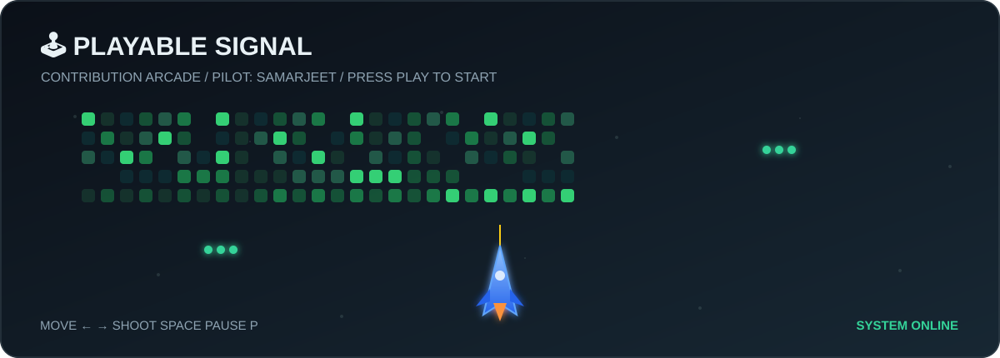

  <h1>Hey 👋 I'm Samarjeet Patil</h1>
  
  

    
    
  

## 📌 About Me

- 🎓 B.Tech student in **Computer Science & Engineering (AI & ML)** at MIT Academy of Engineering, Pune.
- 🤖 Interested in **Agentic AI, Generative AI, Machine Learning, RAG, and Knowledge Graphs**.
- 🛠️ I enjoy learning by building prototypes, experimenting with tools, and solving practical problems.
- 🚀 **Top 106 teams** — Google Solution Challenge 2026.
- 🏆 **Second Runner-Up** — Nirmaan 4.0, with team *The Excluded*.
- 🤝 Interested in hackathons, technical communities, and collaborating with curious builders.

---

## 🧩 Selected Projects

| Project | What it does |
|---|---|
| **AGENTICA — AI Agent Marketplace** | Marketplace concept for specialized Data, Scraping, and Inference agents, with agent discovery and multi-agent workflows. |
| **NETRA — Investigative Intelligence** | Connects entities and evidence across cases using knowledge graphs, graph analytics, and RAG-based retrieval. |
| **Krishi Vikas AI** | Agricultural support platform combining crop-disease assistance with farmer-focused information and services. |
| **FairLens — AI Fairness Auditing** | Workflows to examine and communicate fairness and bias issues in AI/ML systems. |
| **NautilusAI — Marine Intelligence** | Multi-agent marine anomaly detection and ocean-data intelligence. |
| **Worker Safety System** | Ongoing IoT concept combining a fall-detection smart helmet with an inflatable safety vest and emergency response. |

---

## 🛠️ Languages & Tools

  

  
  
  
  
  

---

## 🏆 Achievements

- **Google Solution Challenge 2026:** Selected among the Top 106 teams.
- **Nirmaan 4.0:** Second Runner-Up with team *The Excluded*.

---

## 🕹️ Playable Signal — Contribution Arcade

My profile activity, reimagined as a tiny space-arcade game. **Open the game and see how long you can survive.**

  
   
  

Controls: ← → or A/D to move · Space to shoot · P to pause. On mobile, use the on-screen controls.

---

## 🔗 Connect

  
  

  
  <b>Build. Learn. Experiment. Repeat.</b>

